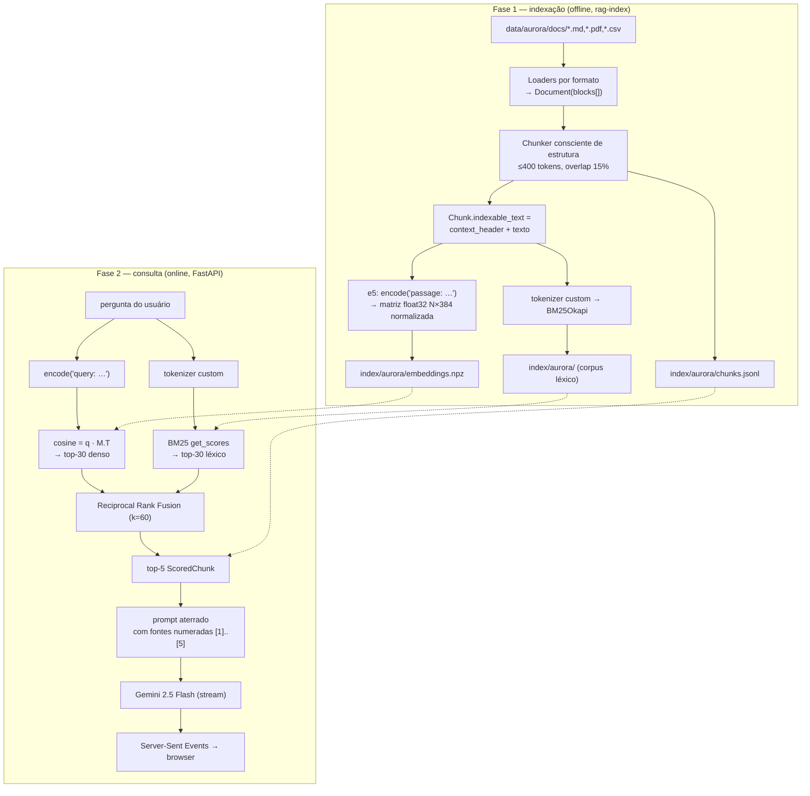

# Guia de estudos — RAG local para documentação de EPI

**Para quem é isto:** você sabe Python, sabe o que é um vetor e um produto interno, e nunca construiu um sistema de RAG. Ao final deste guia você deve conseguir defender cada decisão técnica do projeto diante de um examinador — não repetindo o que está aqui, mas explicando *por quê*.

**Como ler:** na ordem. Cada seção depende da anterior. Ao final de cada seção há uma lista curta de "o que você deve conseguir explicar depois de ler isto" — use como autoavaliação. Se você não consegue explicar um item em voz alta, sem olhar, volte.

**Tempo estimado por seção (total ≈ 45 min).** A estimativa é do texto corrido, a ritmo de leitura técnica (~270 palavras/min); refazer os exemplos numéricos com lápis e papel — o que eu recomendo nas seções 5, 6 e 8 — leva mais tempo, e vale.

| # | Seção | Tempo |
|---|-------|-------|
| 0 | O sistema em uma página | 1 min | v
| 1 | Por que RAG existe | 4 min | v
| 2 | Anatomia de um pipeline RAG | 2 min |
| 3 | Ingestão e chunking | 5 min |
| 4 | Embeddings e busca vetorial | 5 min |
| 5 | Busca léxica e BM25 | 5 min |
| 6 | Fusão de rankings | 3 min |
| 7 | Geração aterrada | 5 min |
| 8 | Avaliação de RAG | 5 min |
| 9 | As ferramentas específicas | 5 min |
| 10 | Privacidade e o argumento da pesquisa | 3 min |
| 11 | Limitações conhecidas e trabalho futuro | 2 min |

A lista de leituras (`leituras.md`) é separada e o tempo dela não conta aqui.

---

## 0. O sistema em uma página

Estamos construindo um chatbot interno que responde perguntas sobre **EPI (Equipamento de Proteção Individual)** a partir da documentação de uma empresa fictícia, a "Metalúrgica Aurora". O domínio é regido pela **NR-6** (norma regulamentadora brasileira sobre EPI), com participação de **NR-33** (espaços confinados) e **NR-35** (trabalho em altura).

A motivação da pesquisa é **privacidade**: os documentos de cada empresa são indexados e processados localmente, e o corpus nunca sai da máquina.

Decisões já fixadas — todas serão justificadas ao longo do guia:

| Etapa | Escolha |
|---|---|
| Corpus | ~30 documentos sintéticos em pt-BR (markdown, PDF, CSV) |
| Loaders | um por formato; markdown por headings, PDF via `pypdf` com rastreio de página, CSV uma linha por unidade |
| Chunking | consciente de estrutura, fallback recursivo por sentenças acima de ~400 tokens, ~15% de overlap |
| Embeddings | `intfloat/multilingual-e5-small`, 384 dimensões, local via `sentence-transformers` |
| Vector store | matriz NumPy `float32` em `.npz`, cosine similarity exata |
| Busca léxica | BM25 (`rank_bm25`) com tokenizer que preserva identificadores (`NR-35`, `CA 31.028`, `6.3.1`) |
| Fusão | Reciprocal Rank Fusion, k=60 |
| Geração | Gemini 2.5 Flash via `google-genai`, streaming, thinking budget 0 |
| Serving | FastAPI + Pydantic + Server-Sent Events; frontend HTML/CSS/JS puro |
| Avaliação | gold set de 50 perguntas respondíveis + 10 não respondíveis; Recall@k, MRR, refusal accuracy |
| Tenancy | `data/<empresa>/` e `index/<empresa>/` |

O escopo é **single-turn**: sem histórico de conversa, sem reescrita de query.

---

## 1. Por que RAG existe

### 1.1 O problema: conhecimento paramétrico

Um LLM guarda o que sabe nos seus **pesos** — daí o nome *conhecimento paramétrico*. Durante o pré-treino, o modelo comprime trilhões de tokens de texto em bilhões de números reais. Isso funciona surpreendentemente bem para conhecimento geral, e tem três defeitos fatais para o nosso caso.

**Primeiro: está congelado.** Os pesos refletem o corpus de treino até uma certa data. Se a NR-6 for alterada por portaria amanhã, o modelo continuará respondendo com a redação antiga, com a mesma confiança de antes. Não há como o modelo saber que está desatualizado.

**Segundo: não é verificável.** Quando um LLM afirma "o prazo de substituição do capacete classe B é de 5 anos", não existe nenhum mecanismo interno que aponte para onde essa informação foi aprendida. A informação está distribuída por milhões de pesos. Você não pode auditar, não pode citar, não pode mostrar a um auditor do Ministério do Trabalho de onde veio a resposta. Em um domínio de segurança do trabalho, isso sozinho já inviabiliza o produto.

**Terceiro — e é o ponto central desta pesquisa: o modelo nunca viu os documentos da sua empresa.** A "Política de EPI da Metalúrgica Aurora, revisão 2024", com os prazos internos, os CAs homologados pelo SESMT e a matriz de EPI por função, não estava no corpus de pré-treino de nenhum modelo comercial — nem deveria estar. É documento interno.

### 1.2 Alucinação e aterramento (grounding)

Quando um LLM não sabe algo, ele raramente diz "não sei". Ele produz o texto mais plausível dado o contexto — e texto plausível sobre normas brasileiras de segurança do trabalho tem estrutura de norma brasileira de segurança do trabalho: números de item, prazos, siglas. O resultado é uma **alucinação**: uma afirmação fluente, bem formatada, com aparência de citação, e falsa.

Isso não é um bug que se corrige com um prompt melhor. É consequência direta do objetivo de treino: o modelo foi otimizado para prever o próximo token, não para ter certeza calibrada. Ele produz a continuação mais provável, e "o item 6.3.1 da NR-6 estabelece que…" é uma continuação altamente provável de "segundo a NR-6,".

**Aterramento (grounding)** é a estratégia de mudar o problema: em vez de pedir que o modelo *lembre*, você coloca o texto-fonte dentro do prompt e pede que ele *leia*. A tarefa deixa de ser recuperação de memória e passa a ser compreensão de leitura — algo em que LLMs são muito melhores e, crucialmente, algo que é **verificável**, porque a fonte está ali ao lado da resposta.

### 1.3 Fine-tuning versus retrieval

A alternativa óbvia seria treinar o modelo nos documentos da empresa. Compare honestamente:

| | Fine-tuning | Retrieval (RAG) |
|---|---|---|
| Custo por atualização | re-treinar (horas/GPU, dataset formatado) | reindexar (minutos, CPU) |
| Documento novo | precisa de novo treino | copiar o arquivo e rodar `rag-index` |
| Documento removido | praticamente impossível de "desaprender" | apagar o arquivo e reindexar |
| Proveniência da resposta | nenhuma | trivial: você sabe quais chunks entraram |
| Ensina *formato/estilo* | sim, muito bem | mal |
| Ensina *fatos novos* | mal e de forma instável | sim |
| Corpus fica em texto claro | não (fica diluído nos pesos) | sim, no disco |

A regra prática aceita na área: **fine-tuning ensina comportamento; retrieval fornece conhecimento**. Para "responda no formato de parecer técnico do SESMT", fine-tuning. Para "qual é o prazo de troca do respirador PFF2 na Aurora", retrieval.

Vale notar a assimetria de risco: fine-tuning em documentos internos incorpora informação confidencial nos pesos de um modelo, e essa informação pode vazar por *extraction attacks*. Com RAG o corpus continua sendo um diretório de arquivos com permissões de sistema de arquivos.

### 1.4 O que RAG conserta e o que não conserta

Seja honesto sobre isto no relatório, porque é o erro conceitual mais comum de quem está começando.

**RAG conserta:**
- **Proveniência.** Você sabe exatamente qual trecho de qual documento sustenta cada afirmação, e pode exibi-lo.
- **Atualidade (freshness).** Trocar um `.md` e reindexar atualiza o sistema inteiro.
- **Cobertura de dados privados.** O modelo passa a "conhecer" documentos que nunca viu no treino.
- **Recusa informada.** Se a recuperação não trouxe nada relevante, o sistema tem base objetiva para dizer que não sabe.

**RAG não conserta:**
- **Raciocínio.** Se a resposta exige combinar três documentos numa inferência em cadeia, um modelo fraco continua errando — agora com citações bonitas ao lado do erro.
- **Aritmética e agregação.** "Quantos funcionários da produção usam luva classe 2?" é pergunta de banco de dados. RAG traz trechos, não faz `GROUP BY`.
- **Ambiguidade da pergunta.** "Qual o prazo?", sem dizer de qual EPI, recupera chunks quase aleatórios.
- **Erro na fonte.** Documento interno errado ⇒ resposta errada, agora com citação. Isso é uma feature (você rastreia e corrige o documento), mas precisa ser dito.
- **Aquilo que a recuperação não achou.** Este é o gargalo real: **o teto de qualidade do sistema é a qualidade da recuperação**. Nenhum gerador conserta um contexto que não contém a resposta. Daí a seção 8 avaliar recuperação *separadamente* da geração.

A formulação original do termo está em Lewis et al. (2020), onde o retriever e o gerador eram treinados conjuntamente. O que hoje se chama "RAG" na indústria é quase sempre a versão mais simples e desacoplada que estamos construindo: recuperar com um sistema de IR clássico + moderno, e injetar o resultado no prompt de um LLM congelado. Vale saber a diferença, porque um examinador pode perguntar.

> **O que você deve conseguir explicar depois de ler isto**
> - Por que conhecimento paramétrico é inadequado para documentação interna de empresa — três razões distintas.
> - Por que alucinação é consequência do objetivo de treino e não um bug de prompt.
> - Em que situação fine-tuning é a escolha certa e em que situação RAG é, com um critério em uma frase.
> - Três coisas que RAG explicitamente **não** conserta.
> - Por que a qualidade da recuperação é o teto do sistema inteiro.

---

## 2. Anatomia de um pipeline RAG

Um sistema RAG tem duas fases que rodam em momentos diferentes e devem ser pensadas separadamente.

**Fase 1 — indexação (offline).** Roda quando os documentos mudam. Lê arquivos, quebra em chunks, calcula embeddings, constrói o índice léxico, grava tudo no disco. No nosso projeto é o comando `rag-index`. Custo: segundos a minutos, uma vez.

**Fase 2 — consulta (online).** Roda a cada pergunta. Recupera, funde rankings, monta o prompt, chama o gerador, faz streaming da resposta. Orçamento: centenas de milissegundos até o primeiro token. Custo: por requisição.

A separação importa porque tudo que for caro deve ser empurrado para a fase 1. Calcular embeddings de 1.200 chunks leva dezenas de segundos em CPU; calcular o embedding de *uma* query leva alguns milissegundos. Essa assimetria é o que torna o sistema viável.



### 2.1 O caminho completo de um `.md` até uma resposta citada

Vale seguir um exemplo concreto ponta a ponta, porque é isso que se pede em uma banca.

1. **Arquivo.** `data/aurora/docs/politica-epi.md`, com `## 4. Fornecimento e substituição` e, dentro, `### 4.2 Prazos de substituição`.
2. **Loader.** Produz um `Document` com `title="Política de EPI"` e uma lista de `Block`, cada um com `section_path=("4. Fornecimento e substituição", "4.2 Prazos de substituição")`.
3. **Chunker.** Agrupa blocos vizinhos até ~400 tokens. Sai um `Chunk` com `chunk_id`, `doc_id`, `section_path`, `token_count`, `ordinal`.
4. **Texto indexável.** O chunk recebe seu cabeçalho de contexto:
   ```
   Política de EPI — 4. Fornecimento e substituição — 4.2 Prazos de substituição
   O capacete de segurança classe B deve ser substituído a cada 5 anos ...
   ```
   Esse é o `indexable_text`, que vai tanto para o embedding quanto para o BM25.
5. **Embedding.** `encode("passage: " + indexable_text)` → 384 floats normalizados, uma linha da matriz.
6. **Léxico.** O mesmo texto passa pelo tokenizer custom (que preserva `NR-6` e `6.3.1`) e entra no `BM25Okapi`.
7. **Pergunta.** "Em quanto tempo o capacete precisa ser trocado?"
8. **Recuperação dupla.** Denso: `encode("query: …")` e produto de matriz → ranking. Léxico: `get_scores(tokens)` → ranking.
9. **Fusão.** RRF combina os dois rankings; sai o top-5.
10. **Prompt.** Os 5 chunks entram numerados `[1]`…`[5]`, com a `citation` legível ao lado.
11. **Geração e transporte.** O Gemini responde citando `[1]`, em streaming; cada token vira um evento SSE, e ao final o frontend renderiza o painel de fontes com os scores denso / BM25 / fundido.

O último passo — o *inspector panel* — não é enfeite: é a ferramenta de depuração mais valiosa do projeto. Quando uma resposta sai errada, a primeira pergunta é sempre "a recuperação trouxe o chunk certo?", e o painel responde isso em um olhar.

> **O que você deve conseguir explicar depois de ler isto**
> - Por que indexação e consulta são fases separadas, e qual assimetria de custo justifica isso.
> - O caminho de um arquivo até uma resposta citada, nomeando cada artefato intermediário (`Block`, `Chunk`, `indexable_text`, `ScoredChunk`).
> - Por que o mesmo `indexable_text` alimenta os dois retrievers.
> - Para que serve o painel de inspeção na hora de depurar.

---

## 3. Ingestão e chunking

### 3.1 Por que chunkar

Você não pode jogar 30 documentos inteiros no prompt. Mesmo que coubessem na janela de contexto, três coisas dariam errado: custo por token, latência, e — o efeito mais insidioso — a degradação de atenção em contextos longos, em que modelos usam mal a informação no meio de um contexto muito grande. Mais contexto não é monotonicamente melhor. Além disso, o chunk é a **unidade de recuperação**: você não recupera "um documento", recupera "um pedaço", e o tamanho do pedaço define a granularidade de tudo.

### 3.2 O trade-off real do tamanho do chunk

Este é o trade-off central da ingestão, e ele é genuíno — não existe tamanho universalmente correto.

**Chunks pequenos (100–200 tokens)** dão precisão de recuperação alta — o embedding de um trecho curto representa *um* assunto, e a similaridade fica nítida — mas suficiência de contexto baixa: o trecho pode conter a frase certa e não a condição que a qualifica ("...exceto para atividades com exposição a agentes químicos, conforme item 4.3").

**Chunks grandes (800–1000 tokens)** trazem a resposta junto com suas condicionantes, mas sofrem **diluição semântica** — um único vetor de 384 dimensões tentando representar cinco assuntos fica "no meio" de todos e próximo de nenhum, e a similaridade cai para consultas específicas — além de desperdiçarem janela: 1.000 tokens de prompt para entregar 80 tokens úteis.

**~400 tokens** (`max_chunk_tokens: int = 400`) é o meio-termo padrão da área para documentos normativos: grande o bastante para conter uma subseção inteira de uma NR com seus incisos, pequeno o bastante para que cinco chunks caibam confortavelmente no prompt (5 × 400 = 2.000 tokens de contexto).

Em português, 400 tokens de um tokenizer multilíngue equivalem a grosso modo a 270–300 palavras, ou ~1.700 caracteres — cerca de meia página. Não confie nesta conversão para nada crítico: veja 3.6.

### 3.3 Chunking consciente de estrutura

A abordagem ingênua é fatiar o texto a cada N caracteres. Ela quebra frases no meio, separa um título do seu conteúdo e mistura o fim de uma seção com o começo de outra. Para documentos normativos, isso é especialmente ruim, porque a estrutura *é* a semântica: o item 6.3.1 significa algo por estar sob o item 6.3.

Nossa estratégia: **respeitar as fronteiras que o formato já oferece**, e só recorrer a corte mecânico quando não há alternativa.

- **Markdown:** quebra em headings. Um heading e seu conteúdo formam uma unidade natural. O `section_path` acumula a hierarquia (`("4. Fornecimento", "4.2 Prazos")`).
- **PDF:** extração via `pypdf`, parágrafo a parágrafo, com o número da página registrado em `Block.page`. Rastrear a página é o que permite a citação "Manual de Segurança, página 12" — sem isso, a citação de um PDF é inútil na prática, porque o usuário não consegue conferir.
- **CSV:** uma linha vira uma unidade **atômica** (`Block.atomic = True`). Uma linha da matriz de EPI por função ("Soldador | capacete classe B | luva de raspa | óculos com filtro | avental de raspa") só faz sentido inteira. Cortá-la ao meio produz lixo. Por isso o modelo de dados tem a flag `atomic`: o chunker sabe que não pode fundir nem partir esse bloco.

**Fallback recursivo.** Quando uma unidade estrutural passa de ~400 tokens (um artigo longo, uma seção sem subdivisões), aplica-se um corte recursivo: tente separar por parágrafos; se ainda for grande, por sentenças; se ainda for grande, por caracteres. A ideia é sempre cortar na fronteira menos destrutiva disponível. É esse "menos destrutiva disponível" que define a palavra *recursivo* aqui.

### 3.4 Por que chunks devem ser autossuficientes

Considere este chunk, extraído de uma tabela de prazos:

```
O prazo é de 12 meses, contados da data de entrega registrada na ficha de EPI.
```

Recuperado isoladamente, é inútil e potencialmente perigoso: prazo de quê? O embedding desse texto também é ruim — ele não contém as palavras "capacete", "respirador" ou "EPI", então uma busca por "prazo do respirador" pode nem alcançá-lo.

A solução implementada é o `context_header`: cada chunk carrega, no seu texto indexável, o título do documento e o caminho de seções.

```python
@property
def context_header(self) -> str:
    parts = [self.doc_title, *self.section_path]
    if self.page is not None:
        parts.append(f"página {self.page}")
    return " — ".join(parts)


@property
def indexable_text(self) -> str:
    return f"{self.context_header}\n{self.text}"
```

O chunk vira:

```
Política de EPI — 5. Higienização e guarda — 5.1 Respiradores PFF2 — página 7
O prazo é de 12 meses, contados da data de entrega registrada na ficha de EPI.
```

Isso resolve dois problemas de uma vez. **Na recuperação**, as palavras do cabeçalho entram no embedding e no índice BM25, então uma consulta que menciona o documento ou a seção tem por onde casar. **Na geração**, o LLM recebe um trecho que se explica sozinho e não precisa adivinhar o referente.

O custo: o cabeçalho ocupa tokens (tipicamente 15–30) que se repetem em todos os chunks do mesmo documento. Isso enviesa levemente o BM25 — termos do título de um documento longo aparecem em muitos chunks, o que reduz o IDF deles (ver seção 5). É um preço aceitável e vale saber que existe.

### 3.5 O que o overlap compra

Com 15% de overlap e chunks de 400 tokens, cada chunk repete ~60 tokens do vizinho anterior.

O overlap existe para o caso patológico: uma informação que cai exatamente sobre a fronteira. Se a frase "…devendo o CA ser verificado antes de cada uso" é a última linha do chunk 7 e a condição que a qualifica ("…salvo nos casos previstos em 4.5") é a primeira do chunk 8, sem overlap nenhum dos dois chunks contém a informação completa, e nenhum dos dois será recuperado com boa pontuação.

Com overlap, a fronteira é coberta duas vezes. O custo é real e mensurável: 15% mais vetores para armazenar e comparar, 15% mais texto no índice BM25, e a possibilidade de dois chunks quase idênticos ocuparem duas das cinco vagas do top-5 — um desperdício de contexto que se combate com deduplicação ou com um passo de diversificação (que não implementamos; é trabalho futuro).

Note que, com chunking consciente de estrutura, o overlap importa *menos* do que com corte de tamanho fixo, justamente porque as fronteiras já foram escolhidas em lugares semanticamente bons. 15% é um valor conservador e defensável.

### 3.6 O que dá errado: tabelas, PDFs e tokens

Três armadilhas concretas que você vai encontrar.

**PDFs.** `pypdf` extrai o *stream* de texto do PDF, não o layout visual. Consequências: um PDF escaneado (imagem) devolve string vazia em `extract_text()`, silenciosamente, produzindo um documento indexado com zero conteúdo — **sempre valide o comprimento do texto extraído por página**; layouts em duas colunas saem intercalados; cabeçalhos e rodapés se repetem em todo chunk daquele PDF, poluindo o índice; e hifenização de fim de linha vira `capa-\ncete`, quebrando o casamento léxico.

**Tabelas.** Uma tabela em PDF vira, na extração, uma sequência de células sem estrutura: `Soldador Capacete B 12 Luva raspa 6`. É frequentemente irrecuperável. É exatamente por isso que os dados tabulares do nosso corpus estão em **CSV**, com um loader dedicado que renderiza cada linha como um enunciado legível. Não é conveniência: é a decisão de projeto que evita o modo de falha mais comum de RAG sobre documentos corporativos.

**Contagem de tokens.** O orçamento de 400 tokens só significa algo se medido com o **mesmo tokenizer** do modelo de embedding. Estimando por `len(texto.split())` contra um tokenizer SentencePiece multilíngue, seu chunk de "400 tokens" pode ter 600 reais — e o modelo trunca silenciosamente em 512 (seção 4.6). O certo é usar o tokenizer do próprio modelo: `len(model.tokenizer.encode(texto, add_special_tokens=False))`. Uma heurística de caracteres é aceitável desde que calibrada e com **margem** — 400 como alvo contra um teto real de 512 é justamente essa margem.

> **O que você deve conseguir explicar depois de ler isto**
> - O trade-off precisão de recuperação × suficiência de contexto, e por que ~400 tokens foi escolhido.
> - Por que uma linha de CSV é `atomic` e o que aconteceria se não fosse.
> - O que o `context_header` resolve, na recuperação e na geração, e qual é o seu custo.
> - O caso exato em que o overlap salva a resposta, e o que ele custa.
> - Três modos de falha de extração de PDF e como detectar o pior deles.

---

## 4. Embeddings e busca vetorial

### 4.1 O que é, concretamente, um embedding

Um embedding é uma função que leva um texto a um ponto de $\mathbb{R}^{384}$, treinada de modo que textos com significado próximo caiam próximos. Nada mais místico do que isso.

Concretamente, `intfloat/multilingual-e5-small` produz para cada texto algo assim (primeiros 8 dos 384 valores):

```
[ 0.0412, -0.0873,  0.1105,  0.0037, -0.0291,  0.0654, -0.0128,  0.0910, ... ]
```

Duas advertências que sempre precisam ser ditas na banca:

**Nenhuma dimensão individual significa nada.** Não existe "a dimensão 47 é a dimensão de segurança do trabalho": o modelo não foi treinado com nenhuma pressão para alinhar dimensões a conceitos humanos. O que carrega significado é a **geometria** — distâncias e ângulos relativos entre vetores. Uma dimensão isolada é tão interpretável quanto um único peso de uma rede neural.

**384 é uma escolha de arquitetura, não uma medida de riqueza semântica.** O embedding final é a média (*mean pooling*) dos vetores de token da última camada de um transformer pequeno. Modelos maiores usam 768 ou 1024 dimensões e costumam ser um pouco melhores, ao custo de memória e tempo; para ~1.200 chunks de um domínio estreito, 384 são abundantes.

O que importa é o que o modelo *aprendeu*: ele foi treinado contrastivamente, com pares (consulta, passagem relevante), de modo que a passagem relevante fique mais próxima da consulta do que milhares de negativas. É por isso que funciona para busca — e é por isso que os prefixos da seção 4.5 não são opcionais.

### 4.2 Por que cosine similarity

Queremos medir "quão parecidos são estes dois textos". As candidatas óbvias são distância euclidiana e similaridade do cosseno:

$$\cos(\mathbf{a},\mathbf{b}) = \frac{\mathbf{a}\cdot\mathbf{b}}{\|\mathbf{a}\|\,\|\mathbf{b}\|}$$

O cosseno mede o **ângulo** e ignora a **magnitude** — que é o que queremos, porque a norma de um embedding correlaciona-se com coisas irrelevantes para a busca, sobretudo o comprimento do texto. Dois textos que dizem a mesma coisa, um com 40 e outro com 300 palavras, têm direções parecidas e normas diferentes: a distância euclidiana os julgaria distantes, o cosseno os julga próximos. Além disso, os modelos e5 são *treinados* com objetivo baseado em cosseno — usá-lo na inferência é usar a métrica em que o espaço foi otimizado.

Exemplo mínimo em $\mathbb{R}^4$:

```
a = [0.6, 0.8, 0.0, 0.0]      (‖a‖ = 1)
b = [0.8, 0.6, 0.0, 0.0]      (‖b‖ = 1)
c = [0.0, 0.0, 1.0, 0.0]      (‖c‖ = 1)

cos(a,b) = 0.6·0.8 + 0.8·0.6 = 0.48 + 0.48 = 0.96   → quase o mesmo assunto
cos(a,c) = 0 + 0 + 0 + 0     = 0.00                 → ortogonais, sem relação
```

### 4.3 Normalização transforma cosseno em produto interno — e a busca em uma multiplicação de matrizes

Se todo vetor for normalizado em L2 na indexação ($\|\mathbf{v}\|=1$), o denominador do cosseno vira 1 e:

$$\cos(\mathbf{a},\mathbf{b}) = \mathbf{a}\cdot\mathbf{b}$$

Isso não é uma esperteza cosmética. Significa que buscar em todo o índice é **uma única multiplicação de matrizes**:

```python
# M: (N, 384) float32, cada linha já normalizada, carregada do .npz
# q: (384,)    float32, também normalizado
scores = M @ q  # (N,) -> cosine similarity contra todos os chunks
top = np.argpartition(-scores, k)[:k]
```

Uma linha, sem laço Python, executada por BLAS em código vetorizado. É difícil superar isso em simplicidade e, nesta escala, em velocidade.

**Contas concretas.** Com N = 1.200 chunks e d = 384:
- Memória do índice: `1200 × 384 × 4 bytes = 1.843.200 B ≈ 1,8 MB`. Cabe em cache L3.
- Custo por consulta: `1200 × 384 ≈ 460 mil` multiplicações-acumulações — abaixo de 1 ms em qualquer CPU moderna.

Ou seja: **busca exata, resultado exatamente correto, em tempo desprezível**. Não há nenhuma justificativa técnica para introduzir um banco vetorial aqui.

### 4.4 Quando ANN (FAISS, HNSW) passa a importar

A busca exata é O(N·d) por consulta. O ponto de virada:

| N (chunks) | Memória (float32, d=384) | Multiplicações por consulta | Veredito |
|---|---|---|---|
| 10³ | 1,5 MB | 4×10⁵ | exata, trivial |
| 10⁵ | 150 MB | 4×10⁷ | exata, ainda confortável (poucos ms) |
| 10⁶ | 1,5 GB | 4×10⁸ | fronteira: dezenas a centenas de ms, RAM começa a doer |
| 10⁸ | 150 GB | 4×10¹⁰ | inviável sem ANN |

**ANN (Approximate Nearest Neighbour)** — FAISS com IVF ou PQ, HNSW, ScaNN — troca **exatidão por velocidade**: em vez de comparar contra todos os vetores, comparam-se apenas os de algumas regiões promissoras do espaço, obtendo *recall* de 95–99% dos vizinhos verdadeiros com 10–100× menos trabalho.

Note o que se paga: **você deixa de ter garantia de que o melhor chunk foi encontrado**, e ganha hiperparâmetros novos (`nprobe`, `efSearch`, número de listas) que precisam ser tunados e interagem com a qualidade final de forma difícil de depurar. Introduzir isso com 1.200 chunks seria trocar corretude garantida por complexidade, sem ganho mensurável — e é assim que se escreve no relatório.

A regra prática: **abaixo de ~10⁵ vetores, busca exata; acima de ~10⁶, ANN; entre os dois, meça.**

### 4.5 A assimetria do e5: `query:` e `passage:`

Este é o erro nº 1 de quem usa modelos e5 e não leu o model card, e ele é **silencioso** — o sistema não quebra, só fica pior.

Os modelos da família e5 foram treinados com prefixos de instrução explícitos. Todo texto de documento foi visto no treino como `passage: <texto>`, e toda consulta como `query: <texto>`. Esses prefixos fazem parte da entrada, e o modelo aprendeu a projetar consultas e passagens em regiões compatíveis do espaço justamente por causa deles.

```python
from sentence_transformers import SentenceTransformer

model = SentenceTransformer("intfloat/multilingual-e5-small")

# Indexação — sempre "passage: "
doc_vecs = model.encode(
    [f"passage: {c.indexable_text}" for c in chunks],
    normalize_embeddings=True,
    batch_size=32,
)

# Consulta — sempre "query: "
q_vec = model.encode(f"query: {pergunta}", normalize_embeddings=True)
```

Consequências práticas de errar: **esquecer os dois prefixos** ainda funciona (o modelo foi pré-treinado em texto sem prefixo), mas com qualidade sensivelmente pior — é a falha mais comum e não gera erro nenhum. **Usar o mesmo prefixo nos dois lados**, ou trocá-los, é usar o modelo fora da configuração em que foi treinado. E **mudar o prefixo depois de indexar** é o bug grave: o índice usa uma convenção e as consultas, outra. **Sempre reindexe ao mudar prefixo ou modelo**, e grave a convenção junto ao índice para validar no carregamento.

Um detalhe relacionado: os scores de similaridade do e5 vivem numa faixa **estreita e alta**, tipicamente entre 0,70 e 0,95, mesmo para pares pouco relacionados — efeito do treino contrastivo. Implicação séria: **não use limiar absoluto de similaridade** ("descarte tudo abaixo de 0,8") para decidir se há resposta no corpus. Use o *ranking*, não o valor. É exatamente por isso que o RRF da seção 6 opera sobre posições.

### 4.6 O limite de 512 tokens, e a truncagem silenciosa

O e5-small tem comprimento máximo de sequência de **512 tokens**. Texto além disso é **descartado sem aviso**: nenhuma exceção, nenhum warning, apenas um embedding que representa só o começo do texto.

```python
print(model.max_seq_length)  # 512
```

Isto conecta com a seção 3: o teto de 400 tokens do chunker existe para que, somando o `context_header` (15–30 tokens) e o erro da estimativa de tokens, ainda sobre folga contra 512. É margem de segurança deliberada, não número arbitrário.

Se você subisse `max_chunk_tokens` para 600 "porque cabe mais contexto", os chunks maiores funcionariam no prompt, mas os embeddings cobririam apenas os primeiros ~512 tokens: o final de todo chunk longo ficaria **invisível para a busca densa**. E como o BM25 continuaria indexando o texto inteiro, você teria a assimetria confusa de um chunk recuperável por palavra-chave e não semanticamente. Detectar isso é penoso; evitar por construção é barato.

### 4.7 Por que um modelo multilíngue importa aqui

Nosso corpus e nossas consultas são em **português brasileiro**, com vocabulário técnico-normativo. Isso descarta os modelos monolíngues de inglês, que são maioria e frequentemente os mais bem pontuados em benchmarks.

Um modelo de embeddings treinado só em inglês, aplicado a português, falha de maneira específica: o tokenizer fragmenta palavras portuguesas em pedaços sem sentido (`insalubridade` → `ins`, `al`, `ub`, `rid`, `ade`), o modelo nunca viu esses padrões associados a significado, e o embedding resultante é quase ruído. E, de novo, **não há erro** — só resultados ruins.

`multilingual-e5-small` foi treinado sobre ~100 idiomas com um tokenizer SentencePiece multilíngue de vocabulário grande, o que dá cobertura adequada ao português. Três consequências práticas:

1. **Sinonímia funciona em pt-BR.** "Em quanto tempo trocar o capacete?" recupera um trecho que diz "prazo de substituição: 5 anos", sem partilhar nenhuma palavra de conteúdo. É exatamente o que a busca léxica não consegue fazer, e a razão de existir do canal denso.
2. **Consultas em português alcançam documentos em inglês** e vice-versa — irrelevante para o corpus atual, relevante se entrarem fichas técnicas de fabricante.
3. **Custo:** o modelo é "small" (~470 MB em float32), roda em CPU a poucos milissegundos por texto curto, e o download é uma vez só.

A alternativa seria um modelo treinado especificamente em português (há variantes BERTimbau para similaridade). O trade-off honesto: um modelo pt-only pode ir um pouco melhor em português puro, mas perde cobertura multilíngue e tem ecossistema menor.

> **O que você deve conseguir explicar depois de ler isto**
> - Por que nenhuma dimensão individual de um embedding é interpretável, e o que carrega significado no lugar.
> - Por que cosseno e não distância euclidiana, e por que a normalização transforma a busca inteira em `M @ q`.
> - Com números, por que busca exata é a escolha correta com ~1.200 chunks, e a partir de que ordem de grandeza ANN passa a valer.
> - O que os prefixos `query:` / `passage:` fazem e as quatro maneiras de errá-los.
> - Por que o teto de 400 tokens do chunker existe por causa do limite de 512 do modelo.

---

## 5. Busca léxica e BM25

### 5.1 Onde a busca densa falha

Embeddings são bons em significado e ruins em **identificadores**. O modo de falha é sistemático:

- **`NR-35` vs `NR-33` vs `NR-6`.** Para o embedding, as três strings são quase idênticas: mesmo padrão de caracteres, mesmo contexto de uso, tokenização parecida — a similaridade entre elas é altíssima. Só que **são normas completamente diferentes** (trabalho em altura, espaços confinados, EPI), e trocar uma pela outra é erro grave em segurança do trabalho.
- **`CA 31.028`.** Um número de Certificado de Aprovação é arbitrário por construção: nada em `31.028` o distingue semanticamente de `31.029`, e o modelo nunca viu esse número específico.
- **`6.3.1`.** Referências de item sofrem do mesmo, agravado porque o tokenizer parte isso em `6`, `.`, `3`, `.`, `1`.
- **Jargão interno.** "ficha de EPI modelo A-12", códigos de setor — termos que aparecem em três chunks do corpus e em nenhum lugar do treino do modelo.

Nesses casos, o usuário digitou **exatamente** a string que quer encontrar. Um sistema de *matching* exato acerta trivialmente; um sistema semântico erra de forma sutil. Fingir que embeddings resolvem tudo é o erro conceitual mais caro em RAG sobre domínios normativos.

### 5.2 BM25, explicado de verdade

BM25 (*Best Matching 25*, da família Okapi) é o padrão-ouro de recuperação léxica desde os anos 1990 e continua sendo uma baseline difícil de bater. É uma função de pontuação: dado um documento $D$ e uma consulta $Q$, quanto $D$ combina com $Q$.

$$\text{score}(D,Q) = \sum_{q_i \in Q} \text{IDF}(q_i)\cdot\frac{f(q_i,D)\cdot(k_1+1)}{f(q_i,D) + k_1\cdot\left(1-b+b\cdot\frac{|D|}{\text{avgdl}}\right)}$$

Parece intimidante; são três ideias somadas termo a termo.

**Ideia 1 — IDF: termos raros valem mais.**

$$\text{IDF}(q_i) = \ln\!\left(1 + \frac{N - n(q_i) + 0{,}5}{n(q_i) + 0{,}5}\right)$$

onde $N$ é o número de documentos (aqui, chunks) e $n(q_i)$ é em quantos deles o termo aparece. "de" aparece em todos os chunks → IDF perto de zero → não influencia. "NR-35" aparece em 6 chunks → IDF alto → dominante. Isso é o comportamento certo: quando alguém pergunta "o que a NR-35 exige de cinto tipo paraquedista?", o sinal está em "NR-35" e "paraquedista", não em "o", "que", "de".

**Ideia 2 — saturação de frequência de termo.** A fração central cresce com $f(q_i,D)$, mas com retornos decrescentes, tendendo assintoticamente a $k_1+1$. Um documento que menciona "capacete" 50 vezes não é 50 vezes mais relevante que um que menciona 1 vez — provavelmente é só um documento sobre capacetes. $k_1$ (tipicamente 1,2–1,5) controla a rapidez da saturação. Isto é a diferença essencial entre BM25 e o velho TF-IDF, que era linear em TF e por isso era enganável por repetição.

**Ideia 3 — normalização por comprimento.** O termo $\left(1-b+b\cdot\frac{|D|}{\text{avgdl}}\right)$ penaliza documentos mais longos que a média. Sem ele, documentos longos ganhariam sempre, só por conterem mais palavras. $b \in [0,1]$ controla a intensidade: $b=0$ desliga a normalização, $b=1$ aplica normalização plena. O padrão $b=0{,}75$ é um meio-termo empiricamente robusto.

### 5.3 Um exemplo numérico completo

Vamos calcular à mão. Suponha o índice com $N=400$ chunks, comprimento médio $\text{avgdl}=180$ tokens, $k_1=1{,}5$, $b=0{,}75$.

Consulta: **"prazo de troca do capacete NR-6"**. Após tokenização e remoção de termos sem sinal, os termos que importam são `capacete` (aparece em 40 chunks) e `nr-6` (aparece em 6 chunks).

**IDFs:**

$$\text{IDF}(\text{capacete}) = \ln\!\left(1+\frac{400-40+0{,}5}{40+0{,}5}\right) = \ln(1+8{,}901) = \ln(9{,}901) = 2{,}293$$

$$\text{IDF}(\text{nr-6}) = \ln\!\left(1+\frac{400-6+0{,}5}{6+0{,}5}\right) = \ln(1+60{,}692) = \ln(61{,}692) = 4{,}122$$

Já aqui o essencial: `nr-6` vale **1,8× mais** que `capacete`, sem ninguém ter configurado isso. A estatística do corpus descobriu sozinha qual termo é discriminativo.

**Chunk D** — trecho curto e específico, $|D|=120$ tokens, com `capacete` 4 vezes e `nr-6` 1 vez.

Fator de normalização: $k_1\left(1-b+b\frac{|D|}{\text{avgdl}}\right) = 1{,}5\left(0{,}25+0{,}75\cdot\frac{120}{180}\right) = 1{,}5\cdot 0{,}75 = 1{,}125$

- `capacete`: $\dfrac{4\cdot 2{,}5}{4+1{,}125} = \dfrac{10}{5{,}125} = 1{,}951 \Rightarrow 1{,}951 \times 2{,}293 = \mathbf{4{,}474}$
- `nr-6`: $\dfrac{1\cdot 2{,}5}{1+1{,}125} = \dfrac{2{,}5}{2{,}125} = 1{,}176 \Rightarrow 1{,}176 \times 4{,}122 = \mathbf{4{,}850}$
- **Total: 9,324**

**Chunk E** — trecho longo e genérico, $|E|=400$ tokens, com `capacete` 8 vezes e `nr-6` nenhuma.

Fator: $1{,}5\left(0{,}25+0{,}75\cdot\frac{400}{180}\right) = 1{,}5\cdot 1{,}917 = 2{,}875$

- `capacete`: $\dfrac{8\cdot 2{,}5}{8+2{,}875} = \dfrac{20}{10{,}875} = 1{,}839 \Rightarrow 1{,}839\times 2{,}293 = \mathbf{4{,}216}$
- `nr-6`: ausente → 0
- **Total: 4,216**

**Leitura do resultado.** O chunk D vence com folga (9,3 contra 4,2) apesar de mencionar "capacete" **metade** das vezes. Três mecanismos agiram juntos: a saturação impediu que as 8 ocorrências valessem o dobro das 4 (1,839 contra 1,951 — o chunk longo até *perde* neste termo), a normalização por comprimento penalizou o chunk longo, e o IDF alto de `nr-6` premiou quem tinha o termo raro.

Só para ver a saturação isolada, mantendo $|D|=120$:

| $f$ | fator TF | ganho sobre o anterior |
|---|---|---|
| 1 | 1,176 | — |
| 2 | 1,600 | +0,42 |
| 4 | 1,951 | +0,35 |
| 8 | 2,192 | +0,24 |
| 100 | 2,472 | ~0 |
| ∞ | 2,500 ($=k_1+1$) | — |

A curva achata rápido. É por isso que *keyword stuffing* não funciona contra BM25.

### 5.4 O tokenizer custom, e por que ele é a peça crítica

Todo o poder do BM25 depende de os termos serem partidos do jeito certo. Um tokenizer ingênuo destrói exatamente os identificadores que motivaram usar BM25:

```python
import re

re.findall(r"\w+", "NR-35 e CA 31.028, item 6.3.1")
# ['NR', '35', 'e', 'CA', '31', '028', 'item', '6', '3', '1']
```

Desastre. `NR-35` virou `NR` + `35`; `NR` agora aparece em todo chunk que cite qualquer norma (IDF despenca), e `35` casa com qualquer "35" do corpus — inclusive "35 °C" e "35 minutos". A precisão evapora.

O tokenizer do projeto preserva grupos alfanuméricos ligados por `-`, `.` ou `/`:

```python
TOKEN_RE = re.compile(r"[0-9A-Za-zÀ-ÿ]+(?:[-./][0-9A-Za-zÀ-ÿ]+)*")


def tokenize(text: str) -> list[str]:
    return [t.lower() for t in TOKEN_RE.findall(text)]


tokenize("NR-35 e CA 31.028, item 6.3.1")
# ['nr-35', 'e', 'ca', '31.028', 'item', '6.3.1']
```

Agora `nr-35`, `31.028` e `6.3.1` são termos únicos, raros, com IDF alto — exatamente o comportamento desejado.

Decisões acessórias que valem discutir com honestidade:

- **Normalizar variantes.** O usuário escreve `NR 35`, `NR-35` ou `NR35`. Sem normalização, são três termos distintos e a consulta erra o índice. Uma regra de canonização (`nr\s*-?\s*(\d+)` → `nr-<n>`) resolve, desde que aplicada **igualmente na indexação e na consulta** — qualquer assimetria aqui é um bug invisível.
- **Remover acentos.** Ajuda no português real, em que as pessoas digitam "protecao". Custo: colisões raras e perda da distinção "está"/"esta". Para busca, o ganho de recall costuma valer.
- **Stemming.** `rank_bm25` não faz. Sem ele, "capacete" não casa com "capacetes". Um stemmer de português (RSLP, no NLTK) recupera esses casos mas às vezes erra de forma agressiva. É razoável deixar de fora — até porque **o canal denso já cobre variação morfológica**, que é justamente onde embeddings brilham.

O princípio inegociável: **o mesmo tokenizer, com a mesma normalização, na indexação e na consulta.** Se divergirem, a busca léxica degrada silenciosamente.

### 5.5 Por que híbrido costuma ganhar

Os dois canais falham em situações **complementares**:

| Consulta | Denso | BM25 |
|---|---|---|
| "em quanto tempo trocar o capacete?" | ✅ casa com "prazo de substituição" | ❌ zero palavras em comum |
| "o que diz a NR-35 sobre cinto?" | ⚠️ confunde NR-35 com NR-33 | ✅ casamento exato, IDF alto |
| "CA 31.028 está válido?" | ❌ número sem semântica | ✅ termo rarísssimo, score dominante |
| "quais EPIs o soldador usa?" | ✅ entende a função e o conjunto | ⚠️ depende de as palavras aparecerem |
| "posso reutilizar PFF2 no dia seguinte?" | ✅ entende reutilização/higienização | ⚠️ casa "PFF2" mas perde a intenção |

Como as falhas são pouco correlacionadas, combinar os dois canais é um ganho quase gratuito — e é precisamente por isso que o experimento central do trabalho é a ablação **denso × BM25 × híbrido** sobre o mesmo conjunto de perguntas. Um resultado publicável não é "híbrido é melhor"; é *quanto* melhor, em quais perguntas, e por quê. Espere que o híbrido ganhe na média mas perca em alguma pergunta específica — e que essa pergunta seja a mais interessante do trabalho.

> **O que você deve conseguir explicar depois de ler isto**
> - Três tipos de consulta em que a busca densa falha sistematicamente, com exemplo do corpus de EPI.
> - Os três componentes do BM25 (IDF, saturação de TF, normalização por comprimento) e o que cada um corrige.
> - Fazer um cálculo de BM25 à mão para dois chunks e explicar por que o mais curto venceu.
> - O que `re.findall(r"\w+", "NR-35")` faz de errado e por que isso destrói o IDF.
> - Por que o híbrido ganha, em termos de falhas descorrelacionadas.

---

## 6. Fusão de rankings

### 6.1 O problema: dois rankings, escalas incompatíveis

O canal denso devolve scores de cosseno em $[-1,1]$, na prática concentrados entre 0,70 e 0,95. O BM25 devolve scores não normalizados em $[0,\infty)$ que dependem de $N$, de avgdl, do comprimento da consulta e de quão raros são os termos — podem ser 2 numa consulta e 30 em outra.

Somar 0,87 com 9,32 não significa nada. E normalizar tampouco é trivial:

- **Min-max por consulta** (mapear cada lista para $[0,1]$) é frágil: o *melhor* resultado sempre vira 1,0, mesmo quando é ruim — uma consulta sem nenhuma resposta boa ganha um "1,0" artificial no topo — e o valor de cada item passa a depender do pior item da lista.
- **Z-score** assume distribuição aproximadamente normal, que os scores de BM25, com cauda longa, não têm.
- **Combinação linear ponderada** ($\alpha\cdot\text{denso} + (1-\alpha)\cdot\text{bm25}$, após normalizar) funciona, mas introduz um $\alpha$ a ser tunado *no seu gold set*, o que consome dados de avaliação e cria risco de overfitting em 60 perguntas.

### 6.2 Reciprocal Rank Fusion

RRF (Cormack, Clarke & Buettcher, SIGIR 2009) resolve isso jogando fora os scores e usando apenas as **posições**:

$$\text{RRF}(d) = \sum_{r \in R} \frac{1}{k + \text{rank}_r(d)}$$

onde $R$ é o conjunto de rankings, $\text{rank}_r(d)$ é a posição de $d$ no ranking $r$ (começando em 1), e $k$ é uma constante — 60 no nosso projeto, o valor do artigo original e o padrão adotado pela maioria das implementações.

Documentos ausentes de um ranking simplesmente não contribuem com aquele termo.

**Por que ranks e não scores?** Três razões, todas defensáveis em banca:

1. **Livre de escala.** Rank é rank. Você pode fundir cosseno, BM25, um reranker e o que mais aparecer sem calibrar nada.
2. **Robusto a outliers.** Um BM25 de 47,3 numa consulta com um termo hiper-raro não esmaga o ranking inteiro; ele é apenas "posição 1".
3. **Sem hiperparâmetro a tunar.** $k=60$ funciona bem em uma faixa larga de cenários. Comparado a tunar $\alpha$ num gold set de 60 perguntas, é uma decisão muito mais honesta metodologicamente.

O que se perde: **a informação de margem**. Se o chunk do rank 1 tem cosseno 0,94 e o do rank 2 tem 0,71, o RRF trata isso quase como um empate. Essa é a perda real, e vale reconhecê-la. Na prática, a robustez compensa — e, no caso específico do e5, cujos scores são comprimidos numa faixa estreita (seção 4.5), a informação de margem vale pouco de qualquer forma.

### 6.3 Um cálculo à mão, com k=60

Consulta: **"prazo de troca do capacete NR-6"**. Suponha:

```
Ranking denso (cosine):        Ranking BM25:
1. chunk C  (0.912)            1. chunk A  (9.32)
2. chunk A  (0.897)            2. chunk D  (7.10)
3. chunk E  (0.881)            3. chunk C  (5.44)
4. chunk B  (0.870)            4. chunk F  (4.02)
5. chunk D  (0.864)            5. chunk B  (3.15)
```

Aplicando $\text{RRF}(d) = \sum 1/(60+\text{rank})$:

| Chunk | rank denso | rank BM25 | contribuição denso | contribuição BM25 | **RRF** |
|---|---|---|---|---|---|
| A | 2 | 1 | 1/62 = 0,016129 | 1/61 = 0,016393 | **0,032522** |
| C | 1 | 3 | 1/61 = 0,016393 | 1/63 = 0,015873 | **0,032266** |
| D | 5 | 2 | 1/65 = 0,015385 | 1/62 = 0,016129 | **0,031514** |
| B | 4 | 5 | 1/64 = 0,015625 | 1/65 = 0,015385 | **0,031010** |
| E | 3 | — | 1/63 = 0,015873 | 0 | **0,015873** |
| F | — | 4 | 0 | 1/64 = 0,015625 | **0,015625** |

**Ranking final: A > C > D > B > E > F.**

Três observações que valem mais do que a fórmula:

1. **A venceu C**, embora C fosse o primeiro colocado do canal denso. A razão é consenso: A está em 2º e 1º, C está em 1º e 3º. O RRF premia o acordo entre canais.
2. **D subiu para 3º** mesmo sendo o *último* do ranking denso, porque o BM25 o colocou em 2º. Nenhum canal sozinho o teria posto no pódio.
3. **E e F, vistos por um único canal, caem para baixo de tudo que apareceu nos dois** — mesmo E, que era 3º no denso, fica atrás de B, que era 4º e 5º. Este é o coração do RRF: **aparecer nos dois rankings vale mais do que ir muito bem em um só.**

**O papel de $k$.** Com $k=60$, a diferença entre 1º e 2º lugar é $1/61 - 1/62 = 0{,}000264$, minúscula perto de $1/61 = 0{,}0164$ que se ganha simplesmente por *aparecer*. Isto é: $k$ grande achata as diferenças entre posições e dá peso ao consenso. Com $k=1$, o mesmo cálculo daria A = 1/3 + 1/2 = 0,833 contra C = 1/2 + 1/4 = 0,750, e as posições do topo dominariam — o comportamento se aproxima de "confie no 1º colocado de algum canal".

$k=60$ é o valor do artigo original, obtido empiricamente em coleções TREC, e virou padrão de fato (é também o default de sistemas de busca comerciais que expõem RRF). Adotá-lo sem tunar é uma escolha defensável e reprodutível; tunar $k$ em 60 perguntas seria overfitting.

**Detalhe de implementação.** Como o RRF só precisa de posições, ele funciona melhor com listas de candidatos generosas: o projeto usa `candidates_per_retriever = 30` de cada canal antes de fundir e cortar em `top_k = 5`. Se você fundisse apenas os top-5 de cada um, chunks que estão em 7º num canal e 2º no outro nunca seriam considerados — e são exatamente eles que a fusão existe para resgatar.

> **O que você deve conseguir explicar depois de ler isto**
> - Por que somar um score de cosseno com um score de BM25 não faz sentido, e o que há de errado com min-max por consulta.
> - A fórmula do RRF e o significado de $k$, incluindo o que muda entre $k=1$ e $k=60$.
> - Calcular um RRF à mão e explicar por que um chunk que não foi 1º em canal nenhum pode vencer.
> - O que o RRF perde ao ignorar scores, e por que isso importa pouco com embeddings e5.
> - Por que se funde 30 candidatos por canal e não 5.

---

## 7. Geração aterrada (grounded generation)

Recuperamos cinco chunks. Agora o LLM precisa responder **apenas** a partir deles. Toda a engenharia desta seção existe para tornar essa restrição verificável, não apenas solicitada.

### 7.1 A estrutura do prompt

O prompt tem quatro partes, nesta ordem, e cada uma tem uma função distinta.

```
[1] INSTRUÇÃO DE PAPEL E REGRAS
Você é um assistente que responde perguntas sobre a documentação interna de
segurança do trabalho da Metalúrgica Aurora.

Regras:
- Responda EXCLUSIVAMENTE com base nas fontes numeradas abaixo.
- Não use conhecimento próprio sobre normas regulamentadoras.
- Cite a fonte de cada afirmação usando [n], onde n é o número da fonte.
- Se as fontes não contiverem a resposta, responda exatamente com
  CONTEXTO_INSUFICIENTE e nada mais.
- Responda em português do Brasil, de forma objetiva.

[2] CONTEXTO
[1] Política de EPI § 4. Fornecimento > 4.2 Prazos de substituição
O capacete de segurança classe B deve ser substituído a cada 5 anos ...

[2] Manual de Segurança — página 12
...

[3] Matriz de EPI por Função — linha 14
Função: Soldador | Capacete: classe B | ...

[3] PERGUNTA
Em quanto tempo o capacete precisa ser trocado?

[4] RESPOSTA:
```

Por que nesta ordem: as regras vêm antes do contexto para que o modelo já esteja "no modo restrito" ao lê-lo; a pergunta vem **depois** do contexto porque, em contextos longos, a instrução mais próxima do ponto de geração tende a ter mais influência. É uma heurística empírica difundida, não um teorema — mas é barata e não custa nada seguir.

Note que o cabeçalho de cada fonte é a propriedade `citation` do `Chunk` (`Política de EPI § 4. Fornecimento > 4.2 Prazos de substituição`). O modelo vê o mesmo rótulo que o usuário verá no painel de fontes. Isso mantém resposta, citação e interface alinhadas por construção.

### 7.2 Por que as citações precisam ser verificáveis por máquina

"Cite suas fontes" produz, em modelos livres, coisas como *"conforme a Política de EPI, seção sobre prazos"*. Isso é impossível de verificar automaticamente: você teria que fazer *matching* aproximado de texto livre contra os títulos das seções, e falharia em metade dos casos.

O formato `[n]`, referindo-se a uma **lista numerada que você mesmo construiu**, é verificável com três linhas:

```python
import re

CITATION_RE = re.compile(r"\[(\d+)\]")

cited = {int(m) for m in CITATION_RE.findall(answer)}
valid = set(range(1, len(sources) + 1))

fabricated = cited - valid  # citou [7] com 5 fontes → alucinação de citação
uncited_answer = not cited  # respondeu sem citar nada → suspeito
```

Isso dá três coisas de graça: uma **métrica** (percentual de respostas com citação válida e percentual com citação fabricada, ambos entrando na tabela do relatório); uma **interface** (o frontend converte `[1]` em link para o chunk no painel de fontes, transformando "confie em mim" em "verifique você mesmo"); e um **teste automatizado** (`assert not (cited - valid)` falha se uma mudança de prompt degradar o comportamento).

Repare que a verificação é sobre a *forma*, não sobre a *verdade*: `[1]` pode existir e ainda assim não sustentar a afirmação. Verificar a sustentação exige leitura humana ou um juiz automático (seção 8.5). Diga isso explicitamente, em vez de deixar implícito que citação válida = resposta correta.

### 7.3 Por que um marcador de recusa explícito

Quando o contexto não contém a resposta, o modelo deve emitir a string literal `CONTEXTO_INSUFICIENTE`. No código isso é uma constante única, compartilhada:

```python
INSUFFICIENT_CONTEXT_MARKER = "CONTEXTO_INSUFICIENTE"
```

O comentário no `models.py` diz exatamente por quê: *"mantido como constante para que o prompt, o parser e os testes nunca divirjam"*. Se o texto do marcador estivesse escrito à mão em três lugares, uma edição no prompt quebraria a avaliação silenciosamente.

Por que um marcador e não uma frase natural:

- **Detecção sem ambiguidade.** `marker in answer` é exato. Classificar "não encontrei essa informação nos documentos fornecidos" como recusa exige heurística — e a heurística confunde com "não encontrei restrição para uso de barba", que é uma *resposta*.
- **Métrica direta.** Refusal accuracy vira contagem, não julgamento.
- **Interface distinta.** O frontend pode renderizar recusa de outro modo (sem painel de fontes, sugerindo reformular), o que só é possível se ele distinguir os dois casos.

Trade-off honesto: o marcador é rígido. Modelos às vezes emitem `CONTEXTO INSUFICIENTE` (sem underscore), ou o embrulham em explicações, ou dizem "a resposta parece ser X, mas CONTEXTO_INSUFICIENTE". O parser deve normalizar (upper, sem acentos nem pontuação) antes de comparar, e a política para o caso híbrido precisa ser decidida e documentada — recomendo tratar a presença do marcador como recusa, priorizando falso-negativo sobre resposta não fundamentada, e registrar a frequência.

### 7.4 Temperatura

`gemini_temperature: float = 0.1`. Temperatura escala a distribuição antes da amostragem: alta achata (mais aleatório e "criativo"), baixa concentra (mais determinístico, sempre o token mais provável).

Para geração aterrada queremos **fidelidade à fonte**, não variedade. A tarefa é essencialmente extrativa: encontre a informação no contexto e reformule com clareza. Criatividade aqui tem outro nome: alucinação.

Por que 0,1 e não 0,0? Reprodutibilidade da avaliação (rodar o gold set duas vezes deve dar quase o mesmo resultado, ou a ablação não significa nada), e um valor mínimo diferente de zero evita alguns loops repetitivos degenerados da amostragem estritamente gulosa; a diferença prática entre 0,0 e 0,1 nesta tarefa é pequena.

O ponto honesto: **mesmo com temperatura 0 não há determinismo garantido** em APIs de nuvem. Batching, não-associatividade de ponto flutuante em GPU e atualizações do modelo no servidor produzem variação entre execuções. Registre timestamp e versão do modelo em cada execução e não prometa determinismo no relatório.

### 7.5 Thinking budget — e um aviso de API em movimento

Modelos da geração Gemini 2.5 podem gerar tokens de raciocínio interno antes da resposta visível. Esses tokens não aparecem ao usuário, **mas são cobrados como saída** e adicionam latência antes do primeiro token visível — o que é ruim justamente numa interface de streaming, em que a percepção de velocidade depende do *time to first token*.

A configuração do projeto é `gemini_thinking_budget: int = 0`, isto é, sem raciocínio interno. A justificativa técnica é sólida: nossa tarefa é **compreensão de leitura extrativa sobre ~2.000 tokens de contexto**, não resolução de problema em múltiplas etapas. É exatamente o tipo de tarefa em que thinking adiciona custo e latência sem ganho mensurável. Se o trabalho evoluísse para perguntas que exigem combinar três documentos e comparar prazos, valeria medir o efeito de habilitá-lo — e essa medição seria, ela própria, um resultado interessante.

**Aviso importante, verifique antes de escrever no relatório:** a documentação oficial atual do Gemini API descreve a configuração de raciocínio por um parâmetro **`thinking_level`** com valores qualitativos (`low`, `medium`, `high`), e não por um orçamento numérico `thinking_budget`; ela indica ainda que, para modelos Flash da linha 2.5, **não há opção de desligar completamente**. Ou seja, "thinking budget = 0" reflete uma forma anterior da API.

Trate isso como achado, não como problema: é a ilustração mais concreta possível do risco de depender de uma API em evolução (seção 11), e é exatamente o que a **interface de provider** existe para conter. Consulte `https://ai.google.dev/gemini-api/docs/thinking`, use o que estiver documentado na versão do `google-genai` instalada, e registre no relatório a data da consulta e a versão do SDK.

Esboço de chamada com streaming (adapte a configuração ao que a doc atual indicar):

```python
from google import genai
from google.genai import types

client = genai.Client(api_key=settings.gemini_api_key.get_secret_value())

stream = client.models.generate_content_stream(
    model=settings.gemini_model,  # "gemini-2.5-flash"
    contents=prompt,
    config=types.GenerateContentConfig(
        temperature=settings.gemini_temperature,
        max_output_tokens=settings.gemini_max_output_tokens,
        # configuração de raciocínio: conferir a doc/SDK atual
    ),
)

for event in stream:
    if event.text:  # pode ser None: sempre teste antes de concatenar
        yield event.text
```

### 7.6 A interface de provider

`llm_provider: Literal["gemini", "ollama"]` no `Settings` não é decoração. Ela declara que a geração é um **componente substituível** por trás de um contrato mínimo — algo como:

```python
class LLMProvider(Protocol):
    name: str
    model: str

    def stream(self, prompt: str) -> Iterator[str]: ...
```

Todo o resto do sistema — retrieval, fusão, prompt, parser de citações, detector de recusa, endpoint SSE, avaliação — não sabe qual provider está em uso. Trocar Gemini por Ollama é trocar uma implementação de `stream`. Três consequências que valem no relatório: viabiliza a ablação nuvem × local, torna o argumento de privacidade uma propriedade de arquitetura em vez de uma promessa, e permite testar o pipeline inteiro com um provider falso e determinístico.

> **O que você deve conseguir explicar depois de ler isto**
> - As quatro partes do prompt e por que a pergunta vem depois do contexto.
> - Por que `[n]` é verificável por máquina e "conforme a Política de EPI" não é — e o que a verificação de forma **não** garante.
> - Três vantagens concretas de um marcador literal de recusa sobre uma frase natural, e o modo de falha dele.
> - Por que temperatura baixa em RAG, e por que mesmo assim não se deve prometer determinismo.
> - O que é thinking budget, por que 0 faz sentido para esta tarefa, e por que essa configuração é um exemplo de risco de API.

---

## 8. Avaliação de RAG

### 8.1 Por que avaliar recuperação separadamente da geração

Uma resposta ruim tem duas causas possíveis, com correções opostas:

1. **A recuperação não trouxe o chunk certo.** Nenhum ajuste de prompt conserta isso. O gerador não pode ler o que não recebeu.
2. **A recuperação trouxe o chunk certo e o gerador estragou** — ignorou, contradisse, alucinou por cima, ou recusou sem motivo.

Se você medir apenas a qualidade final da resposta, não sabe qual dos dois ocorreu, e vai passar semanas ajustando o prompt para consertar um problema de chunking. Por isso o gold set rotula **onde a resposta está** (`GoldReference` com `doc_id` e `section`), não qual é a resposta em texto.

Essa escolha vale defender: rotular a localização é barato, objetivo e verificável por um humano em segundos; rotular a resposta ideal em texto é caro, subjetivo, e depois exige comparação semântica — que traz de volta todos os problemas de avaliação automática. Rotulando localização, as métricas de recuperação viram contagens exatas.

O corolário prático: **Recall@k é o teto do sistema.** Se apenas 72% das perguntas têm um chunk relevante no top-5, nenhuma engenharia de prompt levará a acurácia final acima de 72%.

### 8.2 Recall@k

Recall@k = fração de perguntas para as quais **pelo menos um** chunk relevante aparece nas k primeiras posições.

$$\text{Recall@}k = \frac{1}{|Q|}\sum_{q\in Q}\mathbb{1}\!\left[\exists\, d \in \text{top-}k(q) : d \text{ é relevante}\right]$$

Com 50 perguntas respondíveis, se em 43 delas o top-5 contém um chunk da seção rotulada:

$$\text{Recall@}5 = 43/50 = 0{,}86$$

Meça em vários k. O formato do perfil diz coisas diferentes:

| | Recall@1 | Recall@3 | Recall@5 | Recall@10 | Leitura |
|---|---|---|---|---|---|
| Sistema A | 0,62 | 0,80 | 0,86 | 0,92 | saudável: o chunk certo geralmente está lá, às vezes mal ordenado → **um reranker ajudaria** |
| Sistema B | 0,60 | 0,64 | 0,66 | 0,67 | achatado: os chunks relevantes simplesmente **não estão sendo recuperados** → problema de chunking ou de embedding, não de ordenação |

Este diagnóstico — comparar Recall@5 com Recall@10 — é uma das análises mais úteis e mais baratas que você pode fazer, e cabe em um parágrafo do relatório.

**Detalhe de implementação com efeito real:** como o `GoldReference` casa por prefixo do `section_path`, e uma seção pode gerar vários chunks (com overlap!), "relevante" pode ser mais de um chunk. A definição acima — *pelo menos um* — é a certa para RAG, porque basta um chunk suficiente para responder. É diferente do recall clássico de IR, que consideraria a fração de todos os documentos relevantes recuperados. Deixe a definição explícita no relatório; bancas perguntam.

### 8.3 Mean Reciprocal Rank

Recall@5 trata rank 1 e rank 5 como iguais. MRR não: ele mede *quão alto* o primeiro acerto apareceu.

$$\text{MRR} = \frac{1}{|Q|}\sum_{q\in Q}\frac{1}{\text{rank}_q}$$

onde $\text{rank}_q$ é a posição do primeiro chunk relevante (e a parcela é 0 se não houver nenhum no top-k considerado).

Exemplo com 5 perguntas:

| Pergunta | 1º relevante em | Recíproco |
|---|---|---|
| q1 | posição 1 | 1,000 |
| q2 | posição 3 | 0,333 |
| q3 | não encontrado (top-10) | 0,000 |
| q4 | posição 2 | 0,500 |
| q5 | posição 1 | 1,000 |

$$\text{MRR} = \frac{1{,}000+0{,}333+0{,}000+0{,}500+1{,}000}{5} = \frac{2{,}833}{5} = 0{,}567$$

Note quão severa é a penalidade por posição: cair da 1ª para a 3ª posição custa dois terços da contribuição daquela pergunta. Isso é adequado para RAG, porque o gerador presta mais atenção ao começo do contexto, e porque uma resposta encontrada em 1º custa menos tokens de contexto para ser aproveitada.

**Recall@k e MRR respondem perguntas diferentes.** Recall@5: "a informação chegou ao gerador?" MRR: "chegou bem posicionada?" Um sistema pode ter Recall@5 = 0,86 e MRR = 0,52 — a informação chega, mas mal ordenada, e a conclusão é: adicione um reranker. Reporte os dois.

### 8.4 Refusal accuracy

As 10 perguntas não respondíveis existem para medir se o sistema sabe dizer que não sabe. Elas devem ser plausíveis no domínio mas ausentes do corpus — "qual o prazo de troca do EPI de mergulho autônomo?" é boa; "qual a capital da Mongólia?" não testa nada, porque qualquer sistema recusa.

Monte a matriz de confusão explicitamente:

| | Sistema respondeu | Sistema emitiu `CONTEXTO_INSUFICIENTE` |
|---|---|---|
| **Respondível (50)** | 47 ✅ | 3 ❌ recusa indevida |
| **Não respondível (10)** | 2 ❌ alucinação | 8 ✅ recusa correta |

- Taxa de recusa correta (nas não respondíveis): 8/10 = **0,80**
- Taxa de recusa indevida (nas respondíveis): 3/50 = **0,06**
- Acurácia global de recusa: (47+8)/60 = **0,917**

Reporte as duas taxas separadamente, nunca só a global, porque existe um **trade-off explícito e ajustável entre elas**: um prompt mais rígido aumenta a recusa correta e também a indevida. Um sistema que recusa tudo tem 100% de recusa correta e é inútil. Em segurança do trabalho, uma recusa indevida (o usuário procura em outro lugar) é bem menos grave que uma alucinação confiante sobre prazo de troca de EPI — então errar para o lado conservador é defensável, desde que dito.

**Nota metodológica:** as duas alucinações acima ocorreram *com contexto irrelevante recuperado* — a recuperação sempre devolve top-5, mesmo quando nada presta, porque o ranking não tem noção de "vazio". Extensão natural e barata: usar o score do canal léxico como sinal de abstenção antes mesmo de chamar o LLM (BM25 muito baixo em todos os candidatos ⇒ provavelmente nenhum termo da pergunta existe no corpus). Isso funciona com BM25 e **não** com o cosseno do e5, pelo motivo da seção 4.5.

### 8.5 O perigo de gold sets gerados por LLM

É tentador pedir a um LLM que gere as 60 perguntas a partir do corpus. É rápido, e é uma armadilha metodológica séria:

- **Vazamento de formulação.** Perguntas geradas a partir de um chunk reusam suas palavras, inflando artificialmente tanto o BM25 (casamento léxico direto) quanto o denso (o embedding da pergunta fica perto do chunk que a gerou). A ablação passa a medir o gerador de perguntas, não o sistema.
- **Distribuição irrealista.** Usuários reais escrevem "posso usar barba com PFF2?"; um LLM escreve "Quais são os requisitos estabelecidos para a utilização de respiradores purificadores de ar por trabalhadores que apresentam pelos faciais?". As duas exercitam o sistema de formas muito diferentes.
- **Circularidade.** Se o mesmo modelo gera e responde, você mediu autoconsistência.
- **Não respondíveis são o pior caso.** Um LLM não sabe confiavelmente o que *não* está no corpus — ele viu apenas os trechos que você mostrou.

O gold set do projeto é **escrito à mão**, e isso entra no relatório como decisão metodológica justificada. 60 perguntas manuais são poucas — o intervalo de confiança de uma proporção com n=50 é largo, na casa de ±10 pontos percentuais — e é honesto reconhecê-lo; mas 60 perguntas honestas valem mais que 600 circulares.

Uso legítimo de LLM aqui: como **assistente de rascunho sob revisão humana**, ou como *juiz* de faithfulness, ciente dos vieses conhecidos de LLM-as-a-judge (posição, verbosidade, auto-preferência). Se usar, documente e valide contra uma amostra anotada por humano.

### 8.6 Como é uma tabela de ablação honesta

O experimento central: **denso × BM25 × híbrido**, mesmas perguntas, mesmos chunks, mesmo k. Formato-alvo (os números abaixo são **ilustrativos**, não resultados):

| Estratégia | Recall@1 | Recall@3 | Recall@5 | Recall@10 | MRR@10 | Latência mediana |
|---|---|---|---|---|---|---|
| dense (e5-small) | 0,58 | 0,76 | 0,82 | 0,88 | 0,684 | 12 ms |
| bm25 | 0,54 | 0,70 | 0,78 | 0,84 | 0,632 | 4 ms |
| hybrid (RRF k=60) | 0,66 | 0,84 | 0,90 | 0,94 | 0,749 | 15 ms |

O que torna uma tabela dessas honesta:

1. **Tudo o mais é idêntico.** Mesmo gold set, mesmo chunking, mesmo `top_k`, mesma versão do índice. Se o chunking mudou entre as linhas, a tabela não mede o que diz medir.
2. **Latência aparece.** Sem ela, "híbrido é melhor" esconde o custo.
3. **Há análise qualitativa junto.** O que convence não é a média, é: *"das 9 perguntas em que o denso falhou e o híbrido acertou, 7 continham um identificador (`NR-35`, `CA`, número de item)"* — evidência direta do mecanismo previsto na seção 5.1, e provavelmente o parágrafo mais valioso do relatório.
4. **Os casos em que o híbrido perde são reportados.** Eles existem: o RRF pode promover um chunk com casamento léxico espúrio, 2º no BM25 e ausente no denso. Reporte quantos e mostre um.
5. **Variância.** A recuperação é determinística (mesmo índice, mesma query ⇒ mesmo ranking) — diga isso. As métricas que dependem do LLM (recusa, citação) variam: rode ao menos 3 vezes e reporte média e desvio.

> **O que você deve conseguir explicar depois de ler isto**
> - Por que o gold set rotula *onde* a resposta está e não *qual* é a resposta.
> - Calcular Recall@5 e MRR à mão a partir de uma tabela de posições, e dizer que pergunta cada métrica responde.
> - Ler um perfil Recall@1/@5/@10 e concluir se o problema é ordenação ou recuperação.
> - Por que as duas taxas de recusa devem ser reportadas separadamente, e qual erro é preferível neste domínio.
> - Quatro razões pelas quais um gold set gerado por LLM invalidaria a ablação.

---

## 9. As ferramentas específicas

Formato: o que faz, a chamada que importa aqui, e o erro típico.

### 9.1 `sentence-transformers`

**O que faz.** Embrulha modelos transformer de embedding com pooling, normalização, batching e barra de progresso, expondo tudo por um método `encode`. A base teórica é o Sentence-BERT (Reimers & Gurevych, 2019): fazer *pooling* das saídas de um encoder treinado com objetivo siamês, em vez de rodar o transformer sobre cada par — o que reduz busca em milhares de documentos de horas para milissegundos.

**A chamada que importa.**
```python
model = SentenceTransformer("intfloat/multilingual-e5-small", device="cpu")
vecs = model.encode(
    texts, normalize_embeddings=True, batch_size=32, show_progress_bar=True
)  # -> np.ndarray (N, 384)
```
`normalize_embeddings=True` é o que permite usar produto interno como cosseno (seção 4.3). Faça isso **na indexação e na consulta**.

**O que costuma dar errado.** O `encode` devolve `float32`, mas qualquer manipulação intermediária em Python puro (`np.array([list(v) for v in vecs])`) promove para `float64`, dobrando a memória do índice. Fixe explicitamente: `vecs.astype(np.float32, copy=False)`. Segundo: o download do modelo (~470 MB) ocorre na primeira execução — o primeiro `rag-index` numa máquina limpa parece travado quando está apenas baixando.

### 9.2 NumPy `.npz`

**O que faz.** `.npz` é um arquivo ZIP contendo vários arrays `.npy`. É o jeito padrão de persistir arrays NumPy sem dependências externas — o nosso "banco vetorial".

**A chamada que importa.**
```python
np.savez_compressed(path, embeddings=matrix, chunk_ids=np.array(ids))

with np.load(path) as z:  # NpzFile é lazy: só descomprime o que se acessa
    matrix = z["embeddings"]
```
Use sempre **argumentos nomeados**: eles viram as chaves do `NpzFile`. Com posicionais você recebe `arr_0`, `arr_1`, e o código de leitura fica dependente da ordem de escrita.

**O que costuma dar errado.** `.npz` guarda arrays, não objetos Python. Metadados (nome do modelo, convenção de prefixo, versão do chunker) vão para um JSON ao lado, não para dentro do `.npz` via `allow_pickle` — e guarde-os mesmo: validar no carregamento que o índice foi construído com o mesmo modelo da query elimina toda a classe de bugs silenciosos da seção 4.5.

### 9.3 `rank_bm25`

**O que faz.** Implementação pura em Python de BM25 (Okapi e variantes). Sem índice invertido, sem servidor, sem Elasticsearch: uma classe que recebe o corpus tokenizado e pontua consultas.

**A chamada que importa.**
```python
from rank_bm25 import BM25Okapi

bm25 = BM25Okapi([tokenize(c.indexable_text) for c in chunks])
scores = bm25.get_scores(tokenize(query))  # np.ndarray (N,), um score por chunk
```

**O que costuma dar errado.** Três coisas, em ordem de gravidade:
1. **A biblioteca não tokeniza.** Ela recebe listas de tokens; se você passar strings, cada *caractere* vira um token e o resultado é lixo silencioso. Todo o cuidado da seção 5.4 é responsabilidade sua.
2. **Não há persistência.** Não existe `save()` — você reconstrói o `BM25Okapi` a partir do `chunks.jsonl` ao subir a aplicação. Em 1.200 chunks são milissegundos; em escala grande, um problema real.
3. **IDF negativo.** O `BM25Okapi` usa a variante clássica de IDF, que fica **negativa** para termos presentes em mais de metade dos documentos, e aplica um piso (`epsilon`, 0,25 por padrão, sobre o IDF médio). A fórmula com `1 +` da seção 5.2 é a variante do Lucene, que nunca é negativa. As duas ordenam de forma muito parecida, mas é por isso que reproduzir o exemplo numérico com `rank_bm25` não bate exatamente. Diga qual variante você usou.

### 9.4 `google-genai`

**O que faz.** SDK Python oficial do Google para a Gemini API (substitui o antigo `google-generativeai`).

**A chamada que importa.** `client.models.generate_content_stream(...)`, iterada evento a evento (seção 7.5).

**O que costuma dar errado.** `event.text` pode ser `None` — em eventos de metadados, de *safety*, ou de finalização. Concatenar sem checar levanta `TypeError` no meio de um stream, o que é especialmente desagradável porque já houve resposta parcial enviada ao browser. Sempre `if event.text:`. Além disso: a chave de API entra por variável de ambiente (o `Settings` aceita `RAG_GEMINI_API_KEY`, `GEMINI_API_KEY` ou `GOOGLE_API_KEY`) e é do tipo `SecretStr` do Pydantic justamente para não vazar em `repr()` ou em log — nunca faça `print(settings)` achando que é inofensivo, e nunca comite `.env`.

### 9.5 FastAPI + Pydantic + Server-Sent Events

**FastAPI** é o framework HTTP; **Pydantic** valida e serializa; **SSE** é o transporte do streaming.

**Pydantic** merece nota conceitual: `Chunk`, `ScoredChunk` e `AnswerResult` não são só DTOs de API — são o **modelo de domínio compartilhado** entre ingestão, recuperação, geração e avaliação. Um `AnswerResult` serializa direto para o JSON do endpoint e é exatamente o que o avaliador consome; esse alinhamento é o que impede o relatório de medir uma coisa e a aplicação de servir outra.

**SSE** é um protocolo minúsculo sobre HTTP: `Content-Type: text/event-stream`, e mensagens no formato `data: <payload>\n\n` (linha em branco encerra o evento).

```python
from fastapi.responses import StreamingResponse
import json


@app.post("/ask/stream")
def ask_stream(req: AskRequest):
    def gen():
        for token in pipeline.stream(req.question):
            yield f"data: {json.dumps({'t': token}, ensure_ascii=False)}\n\n"
        yield f"data: {json.dumps({'done': True})}\n\n"

    return StreamingResponse(gen(), media_type="text/event-stream")
```

**O que costuma dar errado**, em ordem de frequência:
1. **Newlines no payload.** SSE é delimitado por linhas: um `\n` cru dentro do texto quebra o evento em dois. Por isso o token vai **dentro de um JSON**, que escapa quebras de linha. Não é firula — respostas com listas e parágrafos contêm `\n` o tempo todo. (Use `ensure_ascii=False`, ou os acentos viram `\uXXXX`.)
2. **`EventSource` só faz GET.** A API nativa do browser não envia corpo POST. Ou a pergunta vai como query string, ou você usa `fetch()` com `ReadableStream` e faz o parsing de SSE à mão — poucas linhas, e é o caminho mais comum hoje.
3. **Buffering de proxy.** Nginx e similares acumulam a resposta e entregam tudo de uma vez, matando o streaming. Envie `X-Accel-Buffering: no` e desative compressão nesse endpoint.
4. **Bloquear o event loop.** Um `def` (não `async def`) roda em threadpool, o que é seguro; um `async def` que chama biblioteca bloqueante trava o servidor inteiro.

### 9.6 `pypdf`

**O que faz.** Lê PDFs em Python puro; para nós, extrai texto por página.

**A chamada que importa.**
```python
from pypdf import PdfReader

reader = PdfReader(path)
for i, page in enumerate(reader.pages, start=1):
    text = page.extract_text() or ""
```

**O que costuma dar errado.** `extract_text()` devolve `""` (ou quase) para PDFs escaneados — sem exceção, sem aviso. Você indexa um documento vazio e nunca descobre, exceto por uma pergunta que "misteriosamente" não é respondida. **Valide sempre:** se a média de caracteres por página for muito baixa, emita warning e registre no log da indexação. Depois disso, aplique pós-processamento: junte palavras hifenizadas na quebra de linha, normalize espaços múltiplos e remova cabeçalhos/rodapés repetidos em todas as páginas.

### 9.7 `ruff` e `pytest`

**`ruff`** é linter e formatador em um só binário (Rust; ordens de magnitude mais rápido que flake8 + isort + black), já configurado no `pyproject.toml` com as regras `E,F,I,N,UP,B,SIM,RUF`. Uso: `ruff check --fix .` e `ruff format .`. Detalhe que vale entender: o projeto ignora `RUF001/002/003` (caracteres Unicode "ambíguos") porque **texto em português tem acentos por definição** — sem esse ignore, o linter reclamaria do corpus inteiro. É configuração justificada, não regra silenciada por preguiça.

**`pytest`** roda os testes; com `asyncio_mode = "auto"`, testes `async def` rodam sem o decorador `@pytest.mark.asyncio`.

O que testar, em ordem de retorno sobre esforço: **chunker** (nenhum chunk excede o teto, blocos `atomic` não são partidos, `section_path` preservado); **tokenizer do BM25** (`tokenize("NR-35, CA 31.028, item 6.3.1")` produz exatamente os tokens esperados — um teste de uma linha protegendo a peça mais frágil do sistema); **RRF** (reproduz o cálculo à mão da seção 6.3); **parser de citações e detector de recusa** (com respostas fabricadas, incluindo os casos degenerados); e o **pipeline ponta a ponta com um provider falso**, que testa rota, SSE e serialização sem gastar chamada de API.

Note que só o último toca em rede — e nem esse, de fato. Essa é a razão de o `LLMProvider` ser um protocolo: quase todo o sistema é testável de forma determinística e offline.

> **O que você deve conseguir explicar depois de ler isto**
> - Qual argumento de `encode` viabiliza a busca por produto interno, e por que fixar `float32`.
> - Por que os metadados do índice ficam fora do `.npz` e por que isso previne um bug real.
> - Por que `rank_bm25` não tokeniza por você e o que acontece se você esquecer disso.
> - Por que cada token SSE viaja dentro de um JSON, e por que `EventSource` sozinho não resolve um POST.
> - Como detectar um PDF escaneado antes que ele contamine o índice.

---

## 10. Privacidade e o argumento da pesquisa

### 10.1 O que exatamente sai da máquina hoje

Seja cirúrgico aqui, porque é o coração do trabalho e é onde uma banca vai apertar.

**Nunca sai da máquina:** o corpus completo (`data/<empresa>/docs/`), o índice de embeddings e o índice léxico, todos os chunks **não** recuperados para aquela pergunta (na prática, mais de 99% do corpus por consulta), e o gold set com seus resultados. Toda a etapa de recuperação — chunking, embedding, cosseno, BM25, RRF — roda 100% localmente. **O modelo de embedding roda na sua CPU**, e isso não é detalhe: é a parte quantitativamente maior do processamento de dados sensíveis.

**Sai da máquina, no momento da geração, para os servidores do Google:** a pergunta do usuário (que pode conter nome de funcionário, setor, incidente), o **texto literal** dos 5 chunks recuperados — tipicamente ~2.000 tokens de conteúdo real dos documentos internos — e o prompt de sistema.

Ou seja: a arquitetura é local, **a geração não é**. O trabalho não pode afirmar "o corpus nunca sai da máquina" sem qualificação, porque pedaços dele saem — justamente os mais relevantes para cada pergunta, que são os que alguém interessado gostaria de ver. Ao longo de muitas consultas, um observador do tráfego reconstruiria uma fração substancial do corpus. Isso precisa estar escrito.

Some o que você **não controla**: retenção de logs, jurisdição dos servidores, e as políticas de uso de dados do *tier* contratado (que costumam diferir entre gratuito e pago, e mudam com o tempo). Verifique os termos vigentes, cite a data da consulta, e não faça afirmação sobre retenção que não possa sustentar com a documentação do fornecedor.

### 10.2 Por que a interface de provider é o argumento, e não um detalhe

A contribuição defensável do trabalho não é "construímos um sistema privado" — é: **construímos e medimos um pipeline de RAG cuja única dependência externa é substituível por um único componente**, e demonstramos que a parte que efetivamente processa o corpus inteiro (ingestão, indexação, recuperação) já é local.

Essa formulação é honesta, é verificável linha a linha no código, e transforma a limitação em desenho experimental: o próximo passo é a ablação **Gemini × Ollama** com as mesmas 60 perguntas, medindo a queda de qualidade — que é o custo, em pontos de métrica, da privacidade total. Esse número não existe na literatura para este domínio e para o português, e é uma contribuição pequena mas real.

### 10.3 O que um modelo local em 4 GB de VRAM consegue fazer

Ordens de grandeza, para calibrar expectativa (números aproximados, dependentes de hardware e de quantização):

| Modelo | Quantização | VRAM aproximada | Viável em 4 GB? |
|---|---|---|---|
| 3–4 B params (ex.: `qwen3:4b`, o default do `Settings`) | Q4_K_M | ~2,3–2,7 GB de pesos | ✅ com folga para KV cache |
| 7–8 B params | Q4_K_M | ~4,4–5,0 GB | ❌ estoura; roda parcialmente em CPU, muito lento |
| 7–8 B params | Q3 | ~3,5 GB | ⚠️ cabe, mas a degradação por quantização agressiva é grande |

O consumo não é só de pesos: o **KV cache** cresce com o contexto. Nosso prompt tem ~2.000 tokens de contexto + instruções + resposta, então algo entre 3k e 4k tokens de janela é suficiente — o que é modesto e cabe. Se você aumentasse `top_k` para 10, o cache dobraria; é uma interação real entre decisões de recuperação e viabilidade do modelo local.

O que esperar de um modelo de 4 B quantizado nesta tarefa, que é **extração aterrada com formato rígido** e não raciocínio livre:

- **Provavelmente aceitável:** localizar a informação nos 5 chunks e reformulá-la em português. A tarefa é fácil no sentido relevante — a resposta está literalmente no contexto.
- **Provavelmente pior:** fluência do português, síntese quando a resposta se espalha por dois chunks e, principalmente, **aderência ao formato** — citar `[n]` de forma consistente e emitir o marcador de recusa exatamente. Modelos pequenos seguem instruções de formato de maneira menos confiável, e é disso que o pipeline depende.
- **O risco maior é a recusa.** Reconhecer a *ausência* de informação é mais difícil que encontrá-la. Espere a refusal accuracy cair mais que o Recall — e note que ela não depende da recuperação, então a comparação isola exatamente o efeito do gerador.
- **Desempenho:** dezenas de tokens por segundo em GPU modesta, confortável para streaming (o usuário lê mais devagar que isso).

Isto é hipótese, não resultado. Meça antes de escrever qualquer coisa como conclusão.

### 10.4 Como declarar a limitação no artigo

Uma formulação defensável, em uma frase: *"O pipeline de ingestão, indexação e recuperação executa integralmente em infraestrutura local; a geração, nesta versão, utiliza um modelo em nuvem (Gemini 2.5 Flash), de modo que a pergunta e os trechos recuperados — mas não o corpus nem o índice — são transmitidos ao provedor. A geração é encapsulada por uma interface de provider, e a avaliação com um gerador local via Ollama é apresentada como trabalho em andamento."*

O que **não** fazer: dizer "sistema local de RAG" no título e no resumo e mencionar o Gemini apenas na seção de implementação. Isso é o tipo de coisa que uma banca encontra, e o custo de ser pego é muito maior do que o custo de declarar desde o início.

> **O que você deve conseguir explicar depois de ler isto**
> - Listar, sem hesitar, o que sai e o que não sai da máquina — e por que "o corpus nunca sai" é falso como afirmação absoluta.
> - Por que a etapa que processa o corpus *inteiro* é justamente a que já é local.
> - Como a interface de provider transforma uma limitação em desenho experimental.
> - O que cabe em 4 GB de VRAM e qual métrica deve cair mais com um modelo pequeno, e por quê.

---

## 11. Limitações conhecidas e trabalho futuro

Uma seção de limitações forte melhora o trabalho; ela mostra que você entende o que construiu. Cada item abaixo tem a limitação, por que ela importa e o que a resolveria.

**1. Corpus sintético.** Os ~30 documentos foram escritos para o projeto, ancorados em NR-6/NR-33/NR-35 reais. Isso dá controle total sobre o gold set e evita questões de confidencialidade — mas documentos reais de empresa são mais sujos: inconsistentes, com versões conflitantes, PDFs escaneados, planilhas mal formatadas, siglas internas não definidas. **A validade externa é limitada**; não conclua que a acurácia observada se transfere. Mitigação futura: um estudo com corpus real de empresa parceira, mesmo que pequeno.

**2. Ruído de extração de PDF.** Discutido em 3.6. Se algum PDF tiver extração degradada, a recuperação naqueles documentos cai por um motivo que **não** é o objeto de estudo, contaminando a ablação. Mitigação barata: reportar estatísticas de extração por documento (caracteres por página, páginas vazias) num apêndice.

**3. Single-turn.** Sem histórico e sem *query rewriting*, "e para o soldador?" logo após uma pergunta sobre capacete não funciona: a query vai isolada para os retrievers e não recupera nada útil. É uma limitação de produto grande e uma decisão de escopo correta para uma IC — reescrita de query é um subsistema inteiro, com avaliação própria. Deixe explícito que é escopo, não esquecimento.

**4. Sem reranker.** O pipeline é recall-oriented: 30 + 30 candidatos, fusão, corte em 5, sem nenhum modelo que releia os candidatos. Um *cross-encoder* (que processa o par pergunta-chunk conjuntamente, em vez de comparar dois vetores calculados de forma independente) costuma ser o maior ganho isolado de qualidade em RAG, ao custo de latência. O diagnóstico da seção 8.2 diz quando vale: **se Recall@10 for muito maior que Recall@5, um reranker converte essa folga em acerto.**

**5. Busca exata não escala.** Correta e ótima em 1.200 chunks (seção 4.4), inviável em 10⁸. Afirme explicitamente que é decisão consciente de escala, com o ponto de virada estimado, e não desconhecimento de FAISS/HNSW.

**6. Risco de depreciação de modelo.** `gemini-2.5-flash` é um endpoint de nuvem versionado, que pode ser aposentado, e cujos parâmetros mudam — como vimos em 7.5, a configuração de raciocínio já migrou de orçamento numérico para níveis qualitativos. Um resultado publicado hoje pode não ser reproduzível em 18 meses. Mitigações: fixar a versão do SDK (já feito: `google-genai>=1.0,<2.0`), registrar a string exata do modelo e a data de cada execução, e — a mitigação real — a interface de provider mais um caminho local que você controla.

**7. Gold set pequeno.** Diferenças de 2–3 pontos percentuais entre estratégias **não são estatisticamente distinguíveis** com n=60. Ou você reporta intervalos de confiança e um teste pareado (as três estratégias veem as mesmas perguntas, então pareado é o adequado), ou fala em tendência em vez de superioridade.

**8. Uma empresa, um idioma, um domínio.** A tenancy por diretório funciona bem para poucas empresas, mas não trata controle de acesso *dentro* de uma empresa (nem todo funcionário deveria ver todo documento), não compartilha modelo entre tenants em memória, e não foi testada com corpus de tamanhos muito diferentes.

> **O que você deve conseguir explicar depois de ler isto**
> - Por que o corpus sintético limita a validade externa, e o que o substituiria.
> - Por que a ausência de reranker é uma escolha, e qual medição diria que chegou a hora de adicionar um.
> - Por que diferenças pequenas na tabela de ablação não sustentam afirmação de superioridade com n=60.
> - Duas mitigações concretas para o risco de depreciação da API de geração.

---

## Fechamento

Se você conseguir responder, sem consultar nada, às perguntas abaixo, está pronto para defender o trabalho:

1. Por que não fazer fine-tuning nos documentos da empresa?
2. Por que 400 tokens por chunk, e o que quebra se você usar 1.000?
3. O que acontece se você esquecer o prefixo `passage:` na indexação — e como você descobriria?
4. Por que a busca é uma multiplicação de matrizes, e em que escala isso deixa de bastar?
5. Calcule o BM25 de dois chunks à mão e explique por que o mais curto ganhou.
6. Calcule um RRF à mão e explique por que o 1º colocado do denso perdeu.
7. Por que `CONTEXTO_INSUFICIENTE` e não "não sei"?
8. Qual é a diferença entre Recall@5 e MRR, e o que cada um te manda consertar?
9. O que exatamente sai da sua máquina quando um usuário faz uma pergunta?
10. Qual é a limitação mais séria do trabalho e o que a resolveria?

A lista de leituras está em [`leituras.md`](./leituras.md). Comece pelos itens marcados como **leitura essencial** — são menos de uma hora no total e cobrem o RRF (2 páginas), o report técnico do multilingual-e5 e a página de busca semântica do `sentence-transformers`.


